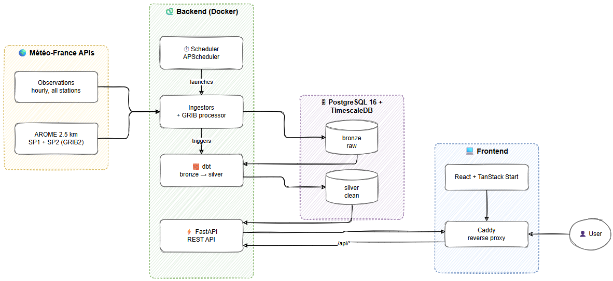
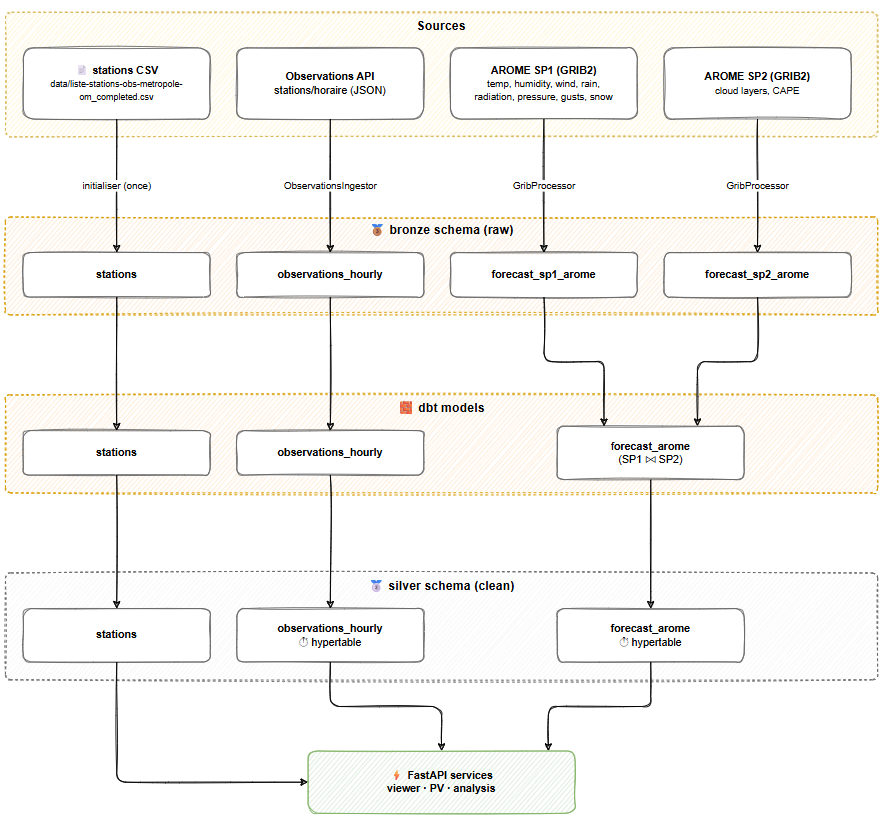
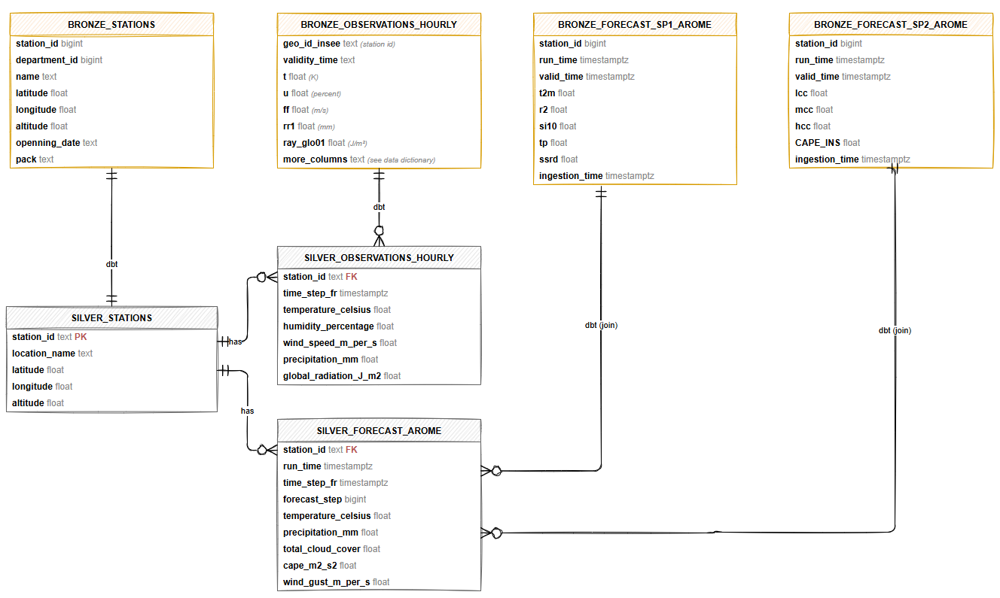
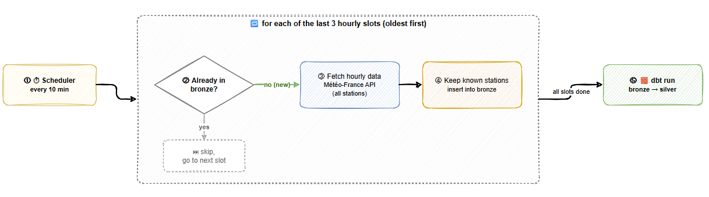
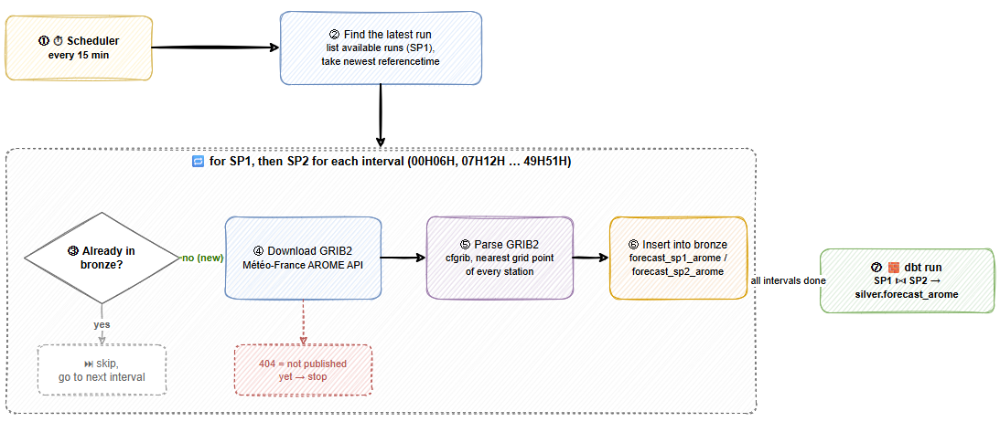
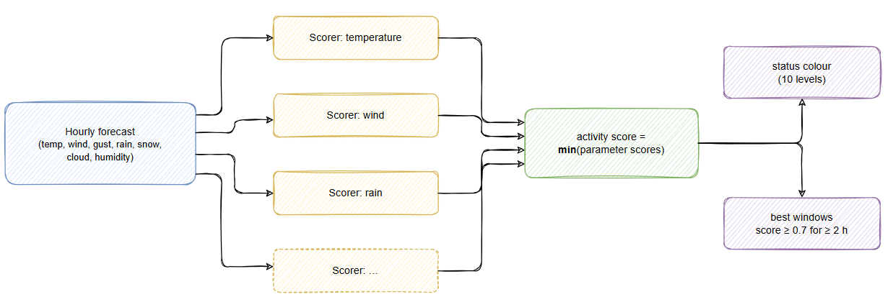
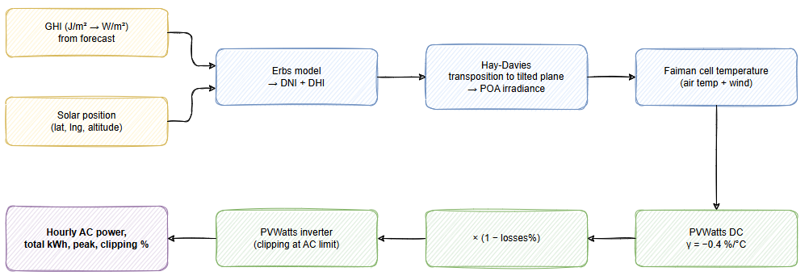
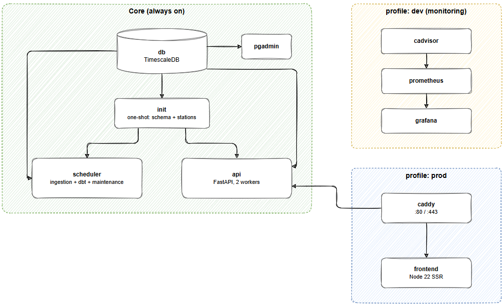
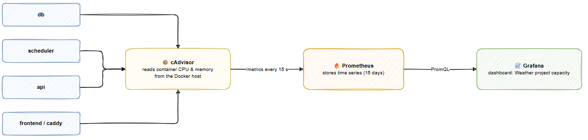
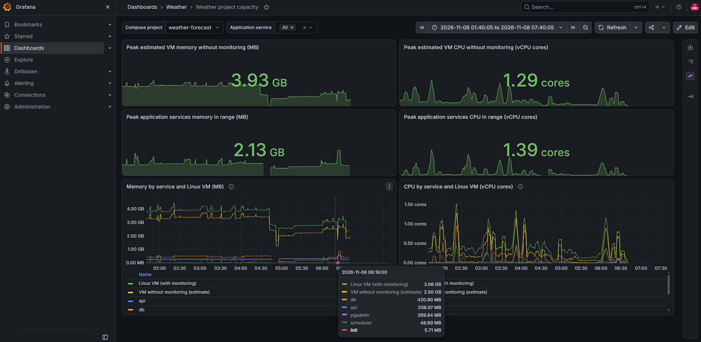

<div align="center">

# ⛅ MeteoApp

### French weather, from the source.

Real **Météo-France** observations and **AROME** forecasts, turned into hourly activity advice, solar-production estimates and a forecast-accuracy lab.


</div>

---

## 📖 What is this project?

**MeteoApp** is a full-stack weather application for **metropolitan France**. Click anywhere on a map (or search an address) and the app finds the nearest Météo-France station and builds a complete picture for that place:

| | Feature | What you get |
|---|---|---|
| 🌤 | **Weather viewer** | Current conditions, 48-hour forecast hourly cards, daily min/max curves, and more detail widgets about humidity, feels-like temperatures etc. |
| 🚴 | **Activity recommendations** | For 8 activities (cycling, running, hiking, picnic, stargazing, gardening, clothing, driving) a score for every hour and the best time windows, so you know roughly when to go and when not to. |
| ☀️ | **Solar (PV) production** | Describe your installation (capacity, tilt, azimuth, inverter, losses) and get hourly AC power, total energy, peak output and inverter-clipping estimates. |
| 📊 | **Forecast accuracy analysis** | Compare AROME forecasts against real observations for all stations available in meteofrance API with MAE / RMSE / bias per forecast horizon and a rain-detection confusion matrix. CSV export included. |
| 🛠 | **Data platform** | A scheduled ingestion pipeline (GRIB2 → PostgreSQL → dbt), a bronze/silver layered database, storage-retention jobs, and a resource-monitoring stack to size a production VM. |

### 🎬 Demo
[▶ Watch the application demo](./docs/videos/Webapp-presentation.mp4)

Click the image to watch the demo.
---

## 📑 Table of contents

- [⛅ MeteoApp](#-meteoapp)
    - [French weather, from the source.](#french-weather-from-the-source)
  - [📖 What is this project?](#-what-is-this-project)
    - [🎬 Demo](#-demo)
  - [Click the image to watch the demo.](#click-the-image-to-watch-the-demo)
  - [📑 Table of contents](#-table-of-contents)
  - [🏗 Architecture at a glance](#-architecture-at-a-glance)
  - [🧰 Tech stack](#-tech-stack)
  - [🗄 Data platform](#-data-platform)
    - [Data flow: source → bronze → silver → API](#data-flow-source--bronze--silver--api)
    - [Schema diagram](#schema-diagram)
    - [Bronze layer: data dictionary](#bronze-layer-data-dictionary)
    - [Silver layer: data dictionary](#silver-layer-data-dictionary)
    - [Bronze → silver transformations](#bronze--silver-transformations)
    - [Storage \& retention strategy](#storage--retention-strategy)
  - [⏱ Ingestion scheduler](#-ingestion-scheduler)
    - [Observation flow](#observation-flow)
    - [Forecast flow (GRIB2)](#forecast-flow-grib2)
  - [🧠 The webapp features](#-the-webapp-features)
    - [Activity scoring](#activity-scoring)
    - [PV production model](#pv-production-model)
    - [Forecast accuracy analysis](#forecast-accuracy-analysis)
    - [Weather codes, feels-like \& widgets](#weather-codes-feels-like--widgets)
  - [🔌 API](#-api)
  - [🚀 Getting started](#-getting-started)
    - [1. Prerequisites](#1-prerequisites)
    - [2. Clone](#2-clone)
    - [3. Configure the environment](#3-configure-the-environment)
    - [4. Start the backend](#4-start-the-backend)
    - [5. Start the frontend](#5-start-the-frontend)
    - [6. Useful local URLs](#6-useful-local-urls)
    - [7. Production-like test on one machine](#7-production-like-test-on-one-machine)
  - [🐳 Docker setup explained](#-docker-setup-explained)
  - [📈 Monitoring \& VM sizing](#-monitoring--vm-sizing)
  - [🧑‍💻 Development tips](#-development-tips)
  - [⚠️ Known limitations \& roadmap](#️-known-limitations--roadmap)
  - [🙏 Credits \& data licence](#-credits--data-licence)
---

## 🏗 Architecture at a glance



The data flows from the source **Météo-France API** and lands in a local database:

1. **Ingestion**: `scheduler` fetches, parses and stores data, then triggers dbt to clean it.
2. **Serving**: `api` reads only from the clean **silver** layer and computes recommendations on the fly.
3. **Presentation**: the React app calls the API and renders maps, charts and cards.

---

## 🧰 Tech stack

| Layer | Technologies |
|---|---|
| **Data source** | Météo-France public APIs: *DPPaquetObs* (observations), *DPPaquetAROME* (forecast model, 0.025° ≈ 2.5 km grid) |
| **Ingestion** | Python 3.11, `requests` (OAuth2 client-credentials), `cfgrib` + `xarray` (GRIB2), APScheduler |
| **Database** | PostgreSQL 16 with TimescaleDB (hypertables, retention policy), `psycopg2` connection pool, pgAdmin |
| **Transformation** | **dbt** (`dbt-postgres 1.7.9`, isolated virtualenv inside the image) |
| **Backend** | FastAPI + Uvicorn, `pvlib` (solar), `shapely` (France boundary check), `numpy` / `pandas` |
| **Frontend** | React 19, TanStack Start / Router / Tailwind CSS v4, Recharts, React-Leaflet, Axios, SunCalc, Meteocons icons |
| **Infra** | Docker Compose, Caddy 2 (reverse proxy + automatic HTTPS) |
| **Monitoring** | cAdvisor → Prometheus → Grafana |

---

## 🗄 Data platform

The database follows a **medallion-style** layout with two layers:

- 🥉 **bronze**: raw, close to the source. Append-only inserts, short retention.
- 🥈 **silver**: cleaned, typed, renamed, and reduced to the variables the app really uses. This is the only layer the API reads.

### Data flow: source → bronze → silver → API


**Key ideas**

- **Stations are the spatial anchor.** AROME is a gridded model; at ingestion time the GRIB grid is sampled at the nearest grid point to each station, so the forecast is stored per station, exactly like the observations.
- **Two AROME packages, one silver table.** SP1 and SP2 are separate products. They are stored separately in bronze and merged on `(station_id, run_time, valid_time)` into one silver table.
- **Everything is stored in UTC.** The database session is forced to `timezone=UTC`; the frontend converts to `Europe/Paris` for display.

### Schema diagram



> The diagram shows key columns only. Full column lists are in the data dictionaries below.

### Bronze layer: data dictionary

Bronze tables are plain PostgreSQL tables created by `scripts/initialiser.py`. Click a table below to expand its columns.

<details>
<summary><b>📋 <code>bronze.stations</code></b> — 8 columns (click to expand)</summary>

Loaded **once** from the CSV by the initialiser (skipped if the table already has rows).

| Column | Type | Definition |
|---|---|---|
| `station_id` | BIGINT | Météo-France station identifier (INSEE-style ID). |
| `department_id` | BIGINT | Département number. |
| `name` | TEXT | Station name. |
| `latitude` / `longitude` | DOUBLE | Station coordinates (°). |
| `altitude` | DOUBLE | Station altitude (m). |
| `openning_date` | TEXT | Date the station opened (source spelling kept). |
| `pack` | TEXT | Observation package the station belongs to. |

</details>

<details>
<summary><b>📋 <code>bronze.observations_hourly</code></b> — 32 columns (click to expand)</summary>

One row per station per hour, as returned by the API (`stations/horaire`). Times are kept as TEXT at this stage. Temperatures are in **Kelvin**.

| Column | Definition (source unit) |
|---|---|
| `lat`, `lon` | Station coordinates (°) |
| `geo_id_insee` | Station ID |
| `reference_time` | Reference time of the data package |
| `insert_time` | Time the record was inserted at Météo-France |
| `validity_time` | Time the observation is valid for (**used as the hourly key**) |
| `t` | Air temperature at 2 m (K) |
| `td` | Dew-point temperature at 2 m (K) |
| `tx`, `tn` | Max / min air temperature over the hour (K) |
| `u` | Relative humidity (%) |
| `ux`, `un` | Max / min relative humidity over the hour (%) |
| `dd` | Mean wind direction (°) |
| `ff` | Mean wind speed (m/s) |
| `dxy`, `fxy` | Direction / speed of the maximum 10-min mean wind |
| `dxi`, `fxi` | Direction / speed of the maximum instantaneous gust |
| `rr1` | Precipitation over the previous hour (mm) |
| `t_10`, `t_20`, `t_50`, `t_100` | Soil temperature at 10 / 20 / 50 / 100 cm depth (K) |
| `vv` | Horizontal visibility |
| `etat_sol` | Ground state code |
| `sss` | Snow depth |
| `n` | Total cloud cover |
| `insolh` | Sunshine duration over the hour |
| `ray_glo01` | Global (solar) radiation over the hour (J/m²) |
| `pres` | Station-level pressure (Pa) |
| `pmer` | Mean-sea-level pressure (Pa) |

</details>

<details>
<summary><b>📋 <code>bronze.forecast_sp1_arome</code></b> — 13 columns (click to expand)</summary>

One row per **station × run × valid time** after sampling the AROME *SP1* GRIB grid.

| Column | Type | Definition |
|---|---|---|
| `station_id` | BIGINT | Station the grid point was sampled for. |
| `run_time` | TIMESTAMPTZ | Time the model run started (e.g. `2026-03-05T12:00Z`). |
| `valid_time` | TIMESTAMPTZ | Time the forecast is valid for. |
| `t2m` | DOUBLE | 2 m temperature (K). |
| `r2` | DOUBLE | 2 m relative humidity (%). |
| `si10` | DOUBLE | 10 m wind speed (m/s). |
| `wdir10` | DOUBLE | 10 m wind direction (°). |
| `ssrd` | DOUBLE | Surface solar radiation downwards, accumulated (J/m²). |
| `tp` | DOUBLE | Total precipitation, accumulated (kg/m² ≡ mm). |
| `prmsl` | DOUBLE | Mean-sea-level pressure (Pa). |
| `fg10` | DOUBLE | Max 10 m wind gust over the step (m/s). |
| `tsnowp` | DOUBLE | Total snow precipitation, accumulated (kg/m²). |
| `ingestion_time` | TIMESTAMPTZ | When the row was ingested. |

</details>

<details>
<summary><b>📋 <code>bronze.forecast_sp2_arome</code></b> — 8 columns (click to expand)</summary>

Same keys as SP1, with cloud and convection variables.

| Column | Type | Definition |
|---|---|---|
| `station_id`, `run_time`, `valid_time`, `ingestion_time` | — | Same meaning as SP1. |
| `lcc` | DOUBLE | Low cloud cover (%). |
| `mcc` | DOUBLE | Medium cloud cover (%). |
| `hcc` | DOUBLE | High cloud cover (%). |
| `CAPE_INS` | DOUBLE | Instantaneous Convective Available Potential Energy (m²/s²): a thunderstorm-potential proxy. |

</details>


### Silver layer: data dictionary

Silver tables are cleaned, typed (`timestamptz`), renamed to explicit names/units, and limited to what the app needs. Click a table below to expand its columns.

<details>
<summary><b>📋 <code>silver.stations</code></b> — 9 columns (click to expand)</summary>

| Column | Type | Definition |
|---|---|---|
| `station_id` | TEXT | Station identifier (cast to text so it joins with the other silver tables). |
| `department_id` | TEXT | Département. |
| `location_name` | TEXT | Human-readable station name (shown in the UI). |
| `latitude`, `longitude`, `altitude` | DOUBLE | Position (°, °, m). |
| `openning_date` | TIMESTAMPTZ | Opening date. |
| `station_type` | TEXT | Station package/type. |
| `transfer_time_fr` | TIMESTAMPTZ | Load timestamp into silver. |

</details>

<details>
<summary><b>📋 <code>silver.observations_hourly</code></b> — 9 columns, hypertable on <code>time_step_fr</code> (click to expand)</summary>

| Column | Type | Definition |
|---|---|---|
| `station_id` | TEXT | Station. |
| `time_step_fr` | TIMESTAMPTZ | Hour the observation applies to (stored in UTC). |
| `temperature_celsius` | DOUBLE | 2 m air temperature (°C). |
| `humidity_percentage` | DOUBLE | Relative humidity (%). |
| `wind_direction_degree` | DOUBLE | Wind direction (°). |
| `wind_speed_m_per_s` | DOUBLE | Mean wind speed (m/s). |
| `precipitation_mm` | DOUBLE | Precipitation over the hour (mm). |
| `global_radiation_J_m2` | DOUBLE | Global radiation over the hour (J/m²). |
| `transfer_time_fr` | TIMESTAMPTZ | Load timestamp into silver. |

</details>

<details>
<summary><b>📋 <code>silver.forecast_arome</code></b> — 19 columns, hypertable on <code>run_time</code> (click to expand)</summary>

| Column | Type | Definition |
|---|---|---|
| `station_id` | TEXT | Station. |
| `run_time` | TIMESTAMPTZ | Model run start. |
| `time_step_fr` | TIMESTAMPTZ | Valid time of the forecast step. |
| `forecast_step` | BIGINT | Lead time of the step within the run. |
| `temperature_celsius` | DOUBLE | 2 m temperature (°C). |
| `humidity_percentage` | DOUBLE | 2 m relative humidity (%). |
| `wind_direction_degree` | DOUBLE | 10 m wind direction (°). |
| `wind_speed_m_per_s` | DOUBLE | 10 m mean wind speed (m/s). |
| `wind_gust_m_per_s` | DOUBLE | 10 m maximum gust (m/s). |
| `CUMUL_precipitation_mm` | DOUBLE | Precipitation accumulated since run start (mm). |
| `precipitation_mm` | DOUBLE | **Hourly** precipitation (mm): difference of the cumulative value. |
| `CUMUL_global_radiation_J_m2` | DOUBLE | Radiation accumulated since run start (J/m²). |
| `global_radiation_J_m2` | DOUBLE | **Hourly** radiation (J/m²), used by the PV model. |
| `CUMUL_snow_precipitation_mm` | DOUBLE | Snow accumulated since run start (mm w.e.). |
| `snow_precipitation_mm` | DOUBLE | **Hourly** snow (mm w.e.). |
| `total_cloud_cover` | DOUBLE | Total cloud cover (%). |
| `cape_m2_s2` | DOUBLE | Convective energy (m²/s²). |
| `mean_sea_level_pressure` | DOUBLE | Sea-level pressure (**Pa**; the API divides by 100 to show hPa). |
| `transfer_time_fr` | TIMESTAMPTZ | Load timestamp into silver. |

</details>

### Bronze → silver transformations

The SQL lives in the dbt project (`dbt/weather_project`). The ingestors trigger it with tags (`tag:observations_hourly`, `tag:forecast_arome`). In summary, going from bronze to silver includes:

| Step | What happens |
|---|---|
| 🔤 **Rename** | Cryptic GRIB/API names → explicit names with units (`t2m` → `temperature_celsius`, `ff` → `wind_speed_m_per_s`, …). |
| 🌡 **Convert units** | Kelvin → Celsius. |
| 🕒 **Type & align times** | Text/UTC timestamps → `timestamptz`; observations keyed on `validity_time`, forecasts on `valid_time`. |
| ➗ **De-accumulate** | AROME rain, snow and radiation are *accumulated since the run start*; hourly values are obtained by differencing consecutive steps (both the `CUMUL_*` and the hourly column are kept). |
| 🔗 **Join SP1 + SP2** | Merged on `(station_id, run_time, valid_time)` into one wide forecast row. |
| ✂️ **Subset** | Only the variables the app needs are kept (≈ 9 of the observation columns, ≈ 15 of the forecast ones). |
| 🏷 **Audit** | `transfer_time_fr` stores when the row reached silver. |

### Storage & retention strategy

AROME produces a new run every 3 hours for ~1,500 stations × ~50 hourly steps × two packages which adds up quickly. Accordingly, to keep up for space, the storage is controlled at three levels, run by `scripts/maintenance.py`:


| Mechanism | Scope | Rule |
|---|---|---|
| **Bronze purge** `purge_old_bronze(keep_days=3)` | `forecast_sp1_arome`, `forecast_sp2_arome` (by `run_time`), `observations_hourly` (by `validity_time`) | Delete everything older than 3 days. Silver is never touched by this job. |
| **Forecast thinning** `thin_forecast_runs(lookback_days=30)` | `silver.forecast_arome` and both bronze forecast tables | For each completed Paris-time day in the last 30 days, keep one randomly-chosen run and delete the others. The current day is skipped (still in progress) and the day containing the latest run is skipped (the viewer still needs it). |
| **Retention policy** | `silver.forecast_arome` | TimescaleDB drops chunks older than 365 days. |
| **Vacuum** | Touched tables | `VACUUM (ANALYZE)` after each job to reclaim space; `--full-vacuum` runs `VACUUM (FULL, ANALYZE)` (locks tables — run off-peak). |

> 🎲 **One *random* run per day** is kept to serve the analysis page. Keeping one run per day preserves a representative sample while liberating space.

---

## ⏱ Ingestion scheduler

`scripts/scheduler.py` is the heart of the data pipeline. It uses APScheduler and launches each job as a separate Python process.

| Job | Schedule (UTC) | Timeout | Module |
|---|---|---|---|
| 🌡 Observations | every **10 min** | 30 min | `scripts.ingest_observations` |
| 🛰 Forecasts | every **15 min** | 60 min | `scripts.ingest_forecasts` |
| 🧹 Maintenance | daily at **03:30** (04:30 / 05:30 Paris) | 30 min | `scripts.maintenance` |

> 🧪 Set `SCHEDULER_TEST=1` to run observations every **1 min** and forecasts every **2 min** while developing.


Météo-France publishes data with some delay and in pieces. Polling frequently with **idempotent** jobs ("skip what is already stored") is simpler and more robust than guessing publication times.

### Observation flow



### Forecast flow (GRIB2)


---

## 🧠 The webapp features

### Activity scoring

Each activity is declared in **`src/forecast/activities/activity_config.py`** as a set of weather parameters. Every parameter has a **`Scorer`** which turns a weather value into:

- a **score between 0 (bad) and 1 (perfect)** via *piece-wise linear interpolation* between hand-defined points, clamped outside the range, and
- a **human message** picked from threshold bands ("*15°C   light jacket recommended*").



**The weakest link decides.** The activity score is the **minimum** of its parameter scores: a perfect temperature does not save a gale. Missing data scores a neutral `0.5` ("Data unavailable").

| Score | Status | Score | Status |
|---|---|---|---|
| ≥ 0.9 | 🟢 dark green | ≥ 0.4 | 🟡 yellow-orange |
| ≥ 0.8 | 🟢 green | ≥ 0.3 | 🟠 orange |
| ≥ 0.7 | 🟢 light green | ≥ 0.2 | 🟠 dark orange |
| ≥ 0.6 | 🟡 yellow-green | ≥ 0.1 | 🔴 red |
| ≥ 0.5 | 🟡 yellow | < 0.1 | 🔴 dark red |

The UI condenses these into three levels: **Good** (≥ 0.7), **Fair** (≥ 0.4), **Poor** (< 0.4).

The API returns up to two runs of consecutive hours with score ≥ 0.7 lasting at least 2 hours, with a short reason.

The thresholds retained are **heuristics**, tuned by hand to be sensible for everyday use, not medical or safety standards.

- **Wind** bands follow the Beaufort scale (3.4 / 5.5 / 8.0 / 10.8 / 13.9 m/s = light breeze / gentle / moderate / fresh / strong).
- **Rain** bands follow the intensity classes of the [Open-Meteo weather-code logic](https://github.com/open-meteo/open-meteo/blob/main/Sources/App/Helper/WeatherCode.swift) (0.1 / 1.3 / 2.5 / 7.6 mm/h = dry / drizzle / light / moderate / heavy).
- **Temperature, gusts, cloud, humidity** ranges are common-sense comfort/safety limits for each activity.

<details>
<summary><b>📋 Full "perfect score" ranges per activity</b> (score = 1.0)</summary>

| Activity | Parameters scored | Ideal conditions (score 1.0) | Falls to ~0 when… |
|---|---|---|---|
| 🚴 **Cycling** | temperature, wind, gusts, rain, snow | 14   28 °C · wind ≤ 3.4 m/s · gusts ≤ 11 m/s · dry · no snow | < −5 °C or > 38 °C · wind ≥ 14 m/s · gusts ≥ 22 m/s · ≥ 8 mm/h rain · ≥ 1 mm snow |
| 🏃 **Running** | temperature, wind, rain | 8 - 18 °C · wind ≤ 5.5 m/s · dry | < −10 °C or > 35 °C · strong wind · heavy rain |
| 🥾 **Hiking** | temperature, wind, gusts, rain, snow | 8 - 22 °C · wind ≤ 8 m/s · gusts ≤ 11 m/s · dry · no snow | < −15 °C or > 34 °C · gales on ridges · heavy rain/snow |
| 🧺 **Picnic** | temperature, wind, rain | 22 - 26 °C · wind ≤ 3.4 m/s · dry | < 0 °C or > 38 °C · wind ≥ 13.9 m/s · rain ≥ 2.5 mm/h |
| 🔭 **Stargazing** | cloud cover, humidity, rain | 0 % cloud · humidity ≤ 50 % · dry | ≥ 90 % cloud · any rain |
| 🌱 **Gardening** | temperature, rain | 13 - 25 °C · dry or light drizzle | extreme heat · heavy rain |
| 🚗 **Driving** | snow, gusts, rain | no snow · gusts ≤ 15 m/s · dry | gusts ≥ 35 m/s · ≥ 1 mm snow · heavy rain |

Additional activities **`fishing`**, **`photography`** and **`dogwalking`** are already defined in the config and can be enabled by adding them to `VIEWER_ACTIVITIES` in `src/forecast/viewer_service.py`.

</details>

**Adding a new activity** takes a single dictionary entry in `ACTIVITIES_CFG`, for example:

```python
'sailing': {
    "id": 'sailing', "icon": '⛵', "label": 'Sailing',
    "parameters": {
        'wind': Param('wind_speed_m_per_s', Scorer(
            points=((3.0, 0.4), (6.0, 1.0), (10.0, 1.0), (14.0, 0.3), (18.0, 0.0)),
            messages=(
                MessageBand(3.0,  '{v:.0f} m/s   too light'),
                MessageBand(10.0, '{v:.0f} m/s   good sailing wind'),
                MessageBand(INF,  '{v:.0f} m/s   too strong'),
            ),
            unknown='Wind unknown',
        )),
    },
},
```

### PV production model

`src/forecast/solar/pv_production.py` uses **[pvlib](https://pvlib-python.readthedocs.io)** and the AROME forecast of the nearest station:



| Input | Default | Meaning |
|---|---|---|
| `system_capacity_kw` | - | DC peak power (kWp) |
| `inverter_capacity_kw` | - | AC output limit (kW) |
| `tilt` / `azimuth` | - | Panel angle (0 = flat, 90 = vertical) / orientation (180 = south) |
| `losses_pct` | 14 % | Wiring, soiling, shading, etc. |
| `inverter_efficiency` | 0.96 | Nominal inverter efficiency |
| `albedo` | 0.25 | Ground reflectance |

Outputs include a plain-language insight comparing the production to an average French household and to electric-car range, and a clipping estimate by recomputing output without the inverter limit.

> ⚠️ It is an estimate: shading, soiling, snow cover and panel degradation are not modelled beyond the loss factor.

### Forecast accuracy analysis

`src/analysis/forecast_analysis.py` pushes the heavy lifting into one SQL query:

1. Join forecast and observation on `(station_id, time_step_fr)`.
2. Aggregate per forecast step (lead time).

| Variable | Metrics | Notes |
|---|---|---|
| 🌡 Temperature | MAE per lead time, overall MAE, RMSE, bias | Overall values are weighted by sample count across lead times. |
| 💨 Wind speed | same | Bias > 0.5 m/s is reported as over/under-estimation. |
| 🌧 Rain | Confusion matrix (TP / FP / FN / TN), precision, recall, F1, specificity, balanced accuracy, accuracy | "Rain" = ≥ 0.1 mm in the hour. Counts are summed, not averaged. |

Each block comes with an automatically generated insight sentence (e.g. *"Temperature forecast accuracy is good with a mean absolute error of 0.8 °C. The model shows no systematic bias."*). Results can be computed for all stations or the nearest station to a clicked point, and exported to CSV.

Adding a new variable is straightforward: all what you have to do is to write result dataclass + a builder and register them in (`ANALYSIS_DEFINITIONS`). A built-in type check catches mismatches between the builder output and the declared contract.

### Weather codes, feels-like & widgets

- **Weather icons**: `src/forecast/codes.py` maps AROME fields to WMO weather codes following Open-Meteo's decision order. The daily icon is the **most severe** code of the day. Icons are [Meteocons](https://meteocons.com), with day/night variants computed in the browser using SunCalc.
- **Feels like**: shaded Steadman apparent temperature: `AT = T + 0.33·e − 0.70·ws − 4.00`.
- **Current conditions**: the observation of the current hour; any missing variable is back-filled from the first forecast hour, and if no observation exists the forecast is used.
- **Daily min/max**: blends today's past hours (observations, then older forecasts if missing) with future forecast hours; the last day is dropped if it has fewer than 12 hours of data.

---

## 🔌 API

Interactive docs are generated by FastAPI at **`/docs`** (Swagger) and **`/redoc`**.

| Method | Endpoint | Description |
|---|---|---|
| `GET` | `/health` | Liveness probe (used by the Docker healthcheck). |
| `GET` | `/station-current-forecast?lat=&lng=` | Nearest station, hourly cards, daily forecast, widgets and all activity scores. |
| `GET` | `/pv-production?lat=&lng=&system_capacity_kw=&inverter_capacity_kw=&tilt=&azimuth=[&losses_pct=14][&inverter_efficiency=0.96]` | Hourly PV production estimate. |
| `GET` | `/analysis?[lat=&lng=][&days=7]` | Forecast accuracy metrics; omit coordinates to aggregate **all stations**. |

- Coordinates outside **metropolitan France** (checked against a GeoJSON polygon with Shapely) return **422**.
- No forecast available yet → **503**.
- In production Caddy exposes the API under `/api/*`.

---

## 🚀 Getting started

### 1. Prerequisites

| Tool | Version | Why |
|---|---|---|
| **Git** | any | Clone the repo |
| **Docker** + **Docker Compose v2** | recent | Runs DB, ingestion, API, monitoring |
| **Node.js** | **22.12+** | Run the frontend in development |
| A **Météo-France API account** | free | Credentials for the observation & AROME APIs ([portail-api.meteofrance.fr](https://portail-api.meteofrance.fr)) |

> 💡 Subscribe your application to the **Observations (DPPaquetObs)** and **AROME (DPPaquetAROME)** APIs on the portal.

### 2. Clone

```bash
git clone https://github.com/<your-username>/weather-forecast.git
cd weather-forecast
```

### 3. Configure the environment


Open `.env` and fill in the values:

| Variable | Required | Description |
|---|---|---|
| `POSTGRES_USER` / `POSTGRES_PASSWORD` / `POSTGRES_DB` | ✅ | Database credentials (created on first start). |
| `METEOFRANCE_APP_ID` | ✅ | Your application credential from the Météo-France portal. It is sent as `Authorization: Basic <APP_ID>` to the token endpoint. |
| `METEOFRANCE_TOKEN_URL` | ✅ | OAuth token endpoint. |
| `METEOFRANCE_BASE_URL` | ✅ | Base URL of the public API. |
| `PGADMIN_EMAIL` / `PGADMIN_PASSWORD` | ✅ | pgAdmin login. |
| `GRAFANA_ADMIN_PASSWORD` | ✅ (monitoring) | Grafana admin password (`GRAFANA_ADMIN_USER` defaults to `admin`). |
| `ENVIRONMENT` | optional | Free-form environment label. |
| `POSTGRES_HOST_PORT`, `API_PORT`, `PGADMIN_PORT` | optional | Host ports (defaults `5433`, `8001`, `5050`). |
| `SITE_ADDRESS` | prod | Domain for Caddy (`:80` by default; a real domain enables automatic HTTPS). |
| `SCHEDULER_TEST` | optional | `1` = faster polling for development. |


### 4. Start the backend

```bash
docker compose up -d --build
```

What happens, in order:

1. `db` (TimescaleDB) starts and becomes healthy.
2. `init` creates schemas, tables, hypertables, indexes and the retention policy, loads the stations CSV, then runs `dbt run --select stations`.
3. `scheduler` and `api` start once `init` completed successfully.
4. The scheduler immediately fetches observations and the latest AROME run.

Check that everything is up:

```bash
docker compose ps
docker compose logs -f scheduler      # watch the first ingestion
curl http://127.0.0.1:8001/health     # → {"status":"ok"}
```

> ⏳ **Be patient on the first start.** The full AROME run (SP1 + SP2, ~50 forecast hours) takes several minutes to download and process. Until a forecast exists, the viewer returns *"No forecast data is available yet"*.

### 5. Start the frontend

```bash
cd frontend
npm ci
npm run dev
```

Open **<http://127.0.0.1:5173>** — the dev server proxies `/api` to `127.0.0.1:8001`.

Don't have credentials or data yet? Set `USE_MOCK_DATA = true` in `frontend/src/app/config.js` to explore the UI with fixtures.

### 6. Useful local URLs

| Service | URL |
|---|---|
| 🌐 App (dev) | http://127.0.0.1:5173 |
| ⚡ API + Swagger | http://127.0.0.1:8001/docs |
| 🐘 pgAdmin | http://127.0.0.1:5050 |
| 🗄 PostgreSQL (host access) | `127.0.0.1:5433` |
| 📈 Grafana *(monitoring profile)* | http://127.0.0.1:3000 |
| 🔥 Prometheus *(monitoring profile)* | http://127.0.0.1:9090 |
| 📦 cAdvisor *(monitoring profile)* | http://127.0.0.1:8081 |


### 7. Production-like test on one machine
In .env you should set the following:

```bash
SITE_ADDRESS=
COMPOSE_PROFILES=prod
```
Then:

```bash
docker compose --profile prod up -d --build
# open http://localhost
```

This adds the **frontend** (Node 22 SSR server) and **Caddy** (port 80/443). Set `SITE_ADDRESS` to your domain to get automatic HTTPS.

To also start monitoring: add `--profile dev` (see below).

---

## 🐳 Docker setup explained


| Service | Image / build | Role | Notes |
|---|---|---|---|
| `db` | `timescale/timescaledb:2.31.0-pg16` | Database | - |
| `init` | `Dockerfile` | Creates schema, loads stations, runs the `stations` dbt model | `restart: "no"`; others wait for its success. |
| `scheduler` | `Dockerfile` | Runs `python -m scripts.scheduler` | - |
| `api` | `Dockerfile` | `uvicorn api.api:app` with 2 workers | - |
| `pgadmin` | `dpage/pgadmin4` | DB UI | Local only. |
| `frontend` | `frontend/Dockerfile` | Multi-stage build → Node SSR server on :3000 | `prod` profile. |
| `caddy` | `caddy:2` | Reverse proxy: `/api/*` → API, everything else → frontend | `prod` profile. |
| `cadvisor`, `prometheus`, `grafana` | official images | Monitoring | `dev` profile. |

**Image design (backend `Dockerfile`)**

- `python:3.11-slim` + the **ecCodes** C library (needed to read GRIB).
- **dbt in its own virtualenv** (`/opt/dbt-venv`) to avoid dependency conflicts.

**Handy commands**

```bash
docker compose logs -f scheduler api       # follow logs
docker compose restart scheduler           # restart one service
docker compose exec db psql -U $POSTGRES_USER -d $POSTGRES_DB
docker compose down                        # stop (keeps data)
docker compose down -v                     # stop AND delete all data volumes ⚠️
```

---

## 📈 Monitoring & VM sizing

A weather pipeline with GRIB processing can be memory-hungry. Before choosing a cloud VM, the project ships with a small observability stack to measure what the application really needs.




| Component | Job | Configuration |
|---|---|---|
| **cAdvisor** | Collects per-container CPU and memory usage by watching the Docker daemon. | Runs privileged with read-only mounts of the host. |
| **Prometheus** | Scrapes cAdvisor every **15 s** and keeps **15 days** of history. Relabels metrics so each series carries `container` and `compose_project` labels. | `monitoring/prometheus.yml` |
| **Grafana** | Visualises the data. Data source and the "Weather project capacity" dashboard are auto-provisioned. | `monitoring/grafana/` |

**Start it**

```bash
docker compose --profile dev up -d
# open http://127.0.0.1:3000  (user: admin / password: GRAFANA_ADMIN_PASSWORD)
```

Then open **Dashboards → Weather → Weather project capacity**.

**What the dashboard shows**

| Panel | Question it answers |
|---|---|
| Peak estimated VM memory without monitoring (MB) | How much RAM does the VM need if I don't deploy the monitoring stack? |
| Peak estimated VM CPU without monitoring (vCPU) | How many cores are needed? |
| Peak application services memory / CPU | The footprint of just `db`, `scheduler`, `api`, `frontend`, `caddy`… |
| Memory by service and Linux VM (time series) | Which container is the hungriest, and **when** (e.g. during GRIB processing). |
| CPU by service and Linux VM (time series) | Same for CPU, with *Compose project* and *Application service* filters. |

> The "VM without monitoring" figure is an **estimate**: total VM usage minus cAdvisor, Prometheus and Grafana.

**How to use the result to pick a VM**

1. Run the full stack for **at least 24 h** (several forecast runs + one maintenance window at 03:30 UTC).
2. Read the peak memory and CPU of the application services.
3. Add headroom (≈ 30 %) for the OS, spikes and growth.
4. Choose the smallest VM that fits, and keep the Docker `mem_limit`s as guardrails.

📸 **Dashboard screenshot**


---

## 🧑‍💻 Development tips

```bash
# Frontend
cd frontend
npm run dev          # dev server on 127.0.0.1:5173

# Backend (inside Docker)
docker compose exec api python -c "from src.data.queries import get_stations; print(len(get_stations()))"
docker compose exec scheduler python -m scripts.ingest_observations   # run one job by hand
docker compose exec scheduler python -m scripts.ingest_forecasts
```

---

## ⚠️ Known limitations & roadmap

- 🇫🇷 Only **metropolitan France** is supported (by design: Météo-France data).
- 📍 The nearest station is found with a simple distance in degrees; a haversine distance would be more accurate.
- 🌫 Fog and freezing rain are not detected (no visibility data in AROME SP1/SP2).
- ☀️ PV estimates ignore shading, soiling and snow beyond the global loss factor.
- 📏 Activity thresholds are heuristics and not official safety guidance. **Always check Météo-France *vigilance* warnings before outdoor activities.**

**Ideas for next steps:** user-defined activity thresholds, more activities in the viewer (fishing, photography), extending beyond France.

---

## 🙏 Credits & data licence

- Weather data © **Météo-France** observations and AROME model outputs, used under the terms of the Météo-France public data licence (Licence Ouverte / Etalab). Please check the current terms on the [Météo-France API portal](https://portail-api.meteofrance.fr).
- Map tiles © [OpenStreetMap](https://www.openstreetmap.org/copyright) contributors; address search via Nominatim.
- Weather icons by [Meteocons](https://meteocons.com).
- Solar modelling with [pvlib-python](https://pvlib-python.readthedocs.io).
- Weather-code logic adapted from [Open-Meteo](https://github.com/open-meteo/open-meteo).

---

<div align="center">

Built with ☕ and a lot of GRIB files.
**If you like this project, give it a ⭐**

</div>
